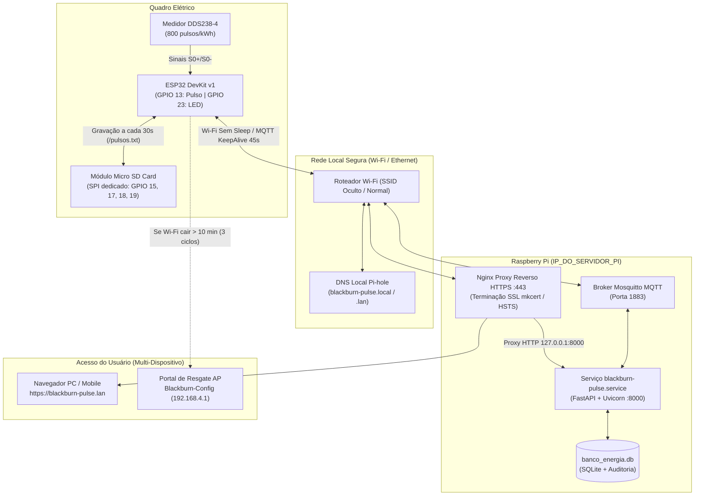
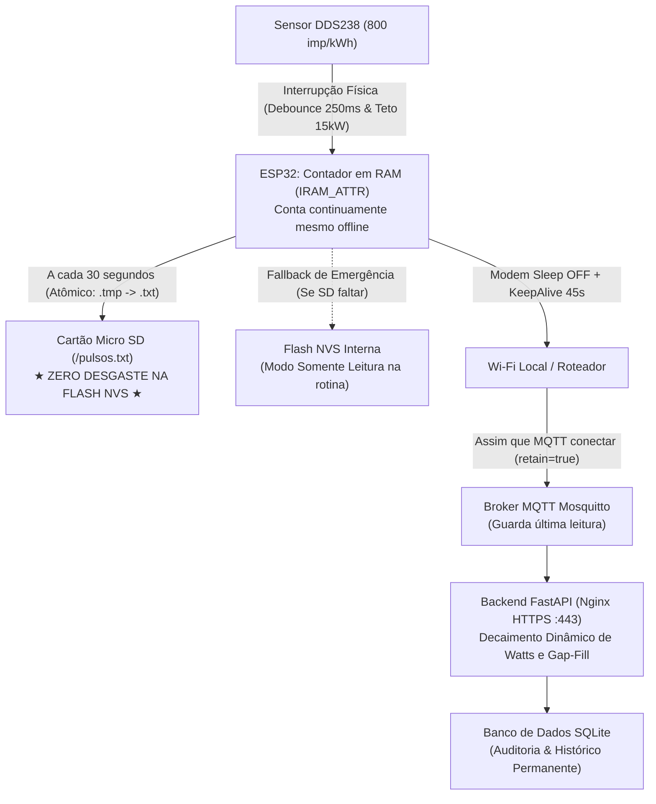

# ⚡ Blackburn-Pulse — Documentação Técnica & Manual de Operações


---


## 📑 Ándice

1. [Visão Geral da Arquitetura](#1-visão-geral-da-arquitetura)

2. [Hardware e Conexões Físicas](#2-hardware-e-conexões-físicas)

3. [Comportamento do LED de Status (GPIO 23)](#3-comportamento-do-led-de-status-gpio-23)

4. [Mecanismos de Resiliência e Tolerância a Falhas](#4-mecanismos-de-resiliência-e-tolerância-a-falhas)

5. [Protocolo de Comunicação MQTT](#5-protocolo-de-comunicação-mqtt)

6. [Estrutura do Banco de Dados SQLite](#6-estrutura-do-banco-de-dados-sqlite)

7. [Manual de Operações — Usuário Final](#7-manual-de-operações--usuário-final)

8. [Manual Técnico & Administração do Sistema](#8-manual-técnico--administração-do-sistema)


---


## 1. Visão Geral da Arquitetura

O **Blackburn-Pulse** é um ecossistema IoT modular de alta disponibilidade para monitoramento, análise de consumo e cálculo tarifário com padrão da concessionária (Enel SP - cálculo tributário "por dentro"), operando sob HTTPS local seguro e armazenamento redundante em hardware.



```


---


## 2. Hardware e Conexões Físicas

### Componentes Utilizados
* **Microcontrolador:** ESP32 DevKit v1 (30 pinos, ESP32-D0WDQ6 com antena integrada)
* **Medidor de Energia:** DDS238-4 em trilho DIN ($800\text{ impulsos} = 1\text{ kWh}$; cada pulso = $1,25\text{ Wh}$, largura óptica $80\text{ ms}$ a $100\text{ ms}$)
* **Módulo de Armazenamento:** Micro SD Card Adapter com regulador de tensão $5\text{V} \to 3,3\text{V}$ integrado
* **Resistor de Pulldown:** $10\text{ k}\Omega$ (ligado entre GPIO 13 e GND)
* **LED Indicador:** LED difuso conectado ao pino GPIO 23 com resistor de $330\ \Omega$

### Pinagem Completa do ESP32

| Pino ESP32 | Fio / Conexão | Módulo / Função | Descrição Técnica |
| :--- | :--- | :--- | :--- |
| **GPIO 13 (D13)** | Amarelo/Verde | Borne **S0-** do DDS238 | Interrupção física (`RISING`) com debounce de **$250\text{ ms}$** e resistor $10\text{ k}\Omega$ ao GND. |
| **GND** | Preto | Borne **S0+** / Fonte | Referência comum aterrada de sinal e alimentação. |
| **GPIO 23 (D23)** | Azul | Ânodo do LED Status | Feedback visual em tempo real (Wi-Fi, MQTT, pulsos e resgate). |
| **GPIO 15 (D15)** | **Fio Marrom** | **Pino CS** (Micro SD) | Chip Select do barramento SPI dedicado. Nível alto em repouso. |
| **GPIO 17 (D17)** | **Fio Roxo** | **Pino MOSI** (Micro SD) | Master Out Slave In do barramento SPI (dados para o cartão). |
| **GPIO 18 (D18)** | **Fio Branco** | **Pino SCK** (Micro SD) | Clock síncrono do barramento SPI. |
| **GPIO 19 (D19)** | **Fio Cinza** | **Pino MISO** (Micro SD) | Master In Slave Out do barramento SPI (dados do cartão). |
| **VIN / 5V** | **Fio Vermelho** | **Pino VCC** (Micro SD) | Alimentação $5\text{V}$ regulada para o conversor interno do adaptador SD. |
| **GND (lado 19)** | **Fio Preto** | **Pino GND** (Micro SD) | Aterramento dedicado para estabilidade da linha SPI. |

---

## 3. Comportamento do LED de Status (GPIO 23)

O LED inteligente do pino 23 comunica o estado de operação em tempo real:

| Padrão de Piscar | Frequência | Significado | O que fazer |
| :--- | :--- | :--- | :--- |
| **Aceso Fixo (Constante)** | — | **100% Operacional** (Wi-Fi e MQTT conectados). | Operação normal. |
| **Piscadinha Breve (Apaga 60ms)** | Ao vivo | **Pulso Registrado** (Confirmação de leitura física). | Indica consumo acontecendo. |
| **Piscando Rápido** | $200\text{ ms}$ | **Buscando Wi-Fi** (Tentando conectar à rede). | Normal durante a inicialização (até 15s). |
| **Piscando Lento** | $500\text{ ms}$ | **Falha no Broker MQTT** (Wi-Fi ok, mas Raspberry fora). | Verificar se o Mosquitto no Raspberry está ativo. |
| **Piscada Dupla a cada 1s** | Duplo | **Modo de Resgate Ativo** (Rede `Blackburn-Config`). | Conectar celular no Wi-Fi `Blackburn-Config` para configurar. |

---

## 4. Mecanismos de Resiliência e Tolerância a Falhas



1. **Interrupção de Hardware em RAM (`IRAM_ATTR`) com Debounce de $250\text{ ms}$:**
   * A contagem roda diretamente na memória RAM estática do processador, imune a delays de rede.
   * **Imunidade Óptica:** O medidor DDS238-4 produz um pulso de $80\text{ ms}$ a $100\text{ ms}$. Um debounce curto ($\le 100\text{ ms}$) causava leitura dupla no repique da descida do optoacoplador ($90\text{ ms}$), resultando em falsos picos de $50.000\text{ W}$. Com o debounce calibrado em **$250\text{ ms}$** e clamp de segurança residencial em **$15.000\text{ W}$**, qualquer ruído espúrio é eliminado na raiz física.

2. **Gravação Atômica no Micro SD a cada 30 Segundos:**
   * O salvamento da contagem ativa ocorre no cartão Micro SD a cada **30 segundos** (apenas se houve novo pulso).
   * **Segurança contra Apagão:** O ESP32 grava primeiro no arquivo temporário `/pulsos.tmp`, executa `flush()` e o renomeia para `/pulsos.txt`. Nunca há risco de corromper o arquivo durante um corte brusco de luz.
   * **Preservação Total da Flash NVS:** A memória Flash do ESP32 tem escrita zero durante a operação normal, eliminando qualquer risco de desgaste prematuro (*wear leveling*).

3. **Migração Transparente e Fallback Redundante:**
   * **Primeiro Boot:** Se o cartão Micro SD for novo ou formatado, o ESP32 lê automaticamente a contagem residual armazenada na Flash NVS e a migra para `/pulsos.txt` no cartão SD, garantindo que o histórico nunca seja zerado.
   * **Tolerância a Falha do SD:** Se o cartão for ejetado ou sofrer dano elétrico, o sistema aciona de forma transparente a Flash NVS interna como linha de defesa secundária.

4. **Estabilidade Wi-Fi 24/7 (Sem Desconexões por Rekeying):**
   * Desativação explícita do sono do rádio (`WiFi.setSleep(false)`), impedindo que o roteador considere o ESP32 inativo durante renovações de chaves criptográficas WPA2 (*Group Rekeying* a cada 30 minutos).
   * KeepAlive MQTT calibrado em **45 segundos**, sincronizado com o Heartbeat de **20 segundos**.

5. **Decaimento Suave da Potência Instantânea:**
   * A potência calculada em tempo real ($\text{Watts} = 4.500.000 / \Delta t$) conta com decaimento dinâmico imediato após 2 segundos sem pulsos, permitindo que a queda de consumo seja refletida na tela no exato instante em que um eletrodoméstico de alta potência é desligado.

6. **Tolerância a Quedas do Roteador (Ciclos Anti-Travamento):**
   * Quando o roteador desliga ou reinicia, o ESP32 tenta reconectar ativamente por 12 vezes seguidas (~3 minutos de espera por ciclo).
   * Se o rádio interno do chip travar durante a ausência do sinal, o ESP32 salva a contagem no SD e realiza um `ESP.restart()` limpo.
   * Limite de Segurança: Após 3 ciclos completos (~10 minutos totais), se o roteador não retornar, ativa o **Portal de Resgate (`Blackburn-Config`)** para permitir reconfiguração via celular em `192.168.4.1`.

7. **Preenchimento Inteligente de Quedas (Offline Gap-Fill):**
   * Se o servidor Raspberry Pi ficar desligado por horas e retornar com diferença acumulada, o backend interpola suavemente medições a cada 30 minutos, evitando "degraus" irreais nos gráficos horários.


---


## 5. Protocolo de Comunicação MQTT


* **Broker:** Mosquitto MQTT no Raspberry Pi (`192.168.2.150:1883`)


### Tópicos Publicados pelo ESP32

| Tópico | Retain | Frequência | Exemplo de Payload |

| :--- | :---: | :--- | :--- |

| `home/energia/status` | Sim | LWT / Boot | `online` ou `offline` |

| `home/energia/dds238` | Sim | A cada pulso e no boot | `{"pulsos": 6913, "kwh": 8.641}` |

| `home/energia/heartbeat` | Não | A cada 20 segundos | `{"status":"online","ip":"192.168.2.14","rssi":-50,"uptime":3600,"pulsos":6913,"kwh":8.641}` |

| `home/energia/config/status` | Sim | Ao reconfigurar | `{"status":"sucesso","mensagem":"Configuracoes salvas no ESP32! Reiniciando..."}` |


> [!NOTE]
> **Cálculo da Potência Ativa Instantânea ($800\text{ imp/kWh}$):**
> $\text{Potência (Watts)} = \frac{3600 \times 1000}{800 \times \Delta t_{\text{seg}}} = \frac{4.500.000}{\Delta t_{\text{ms}}}$
> Onde $\Delta t$ é o tempo decorrido entre os dois últimos pulsos físicos S0.

### Tópicos Subscritos pelo ESP32

| Tópico | Origem | Ação |

| :--- | :--- | :--- |

| `home/energia/config/set` | Backend Web | Recebe JSON com `{"ssid":"...","password":"...","mqtt_server":"..."}`, grava na Flash NVS e reinicia o ESP32 na nova rede. |


---


## 6. Estrutura do Banco de Dados SQLite (`banco_energia.db`)


### Tabela: `historico_consumo`

Registra a série temporal do odômetro físico.

* `id INTEGER PRIMARY KEY AUTOINCREMENT`

* `timestamp TEXT`: Data e hora da leitura (`YYYY-MM-DD HH:MM:SS`)

* `kwh REAL`: Valor absoluto acumulado do relógio no instante


### Tabela: `configuracoes`

Guarda parâmetros numéricos e o ponto de partida do ciclo.

* `leitura_inicial`: Leitura física inicial do relógio no ciclo (ex: `1958.50`)

* `pulsos_iniciais_ciclo`: Pulsos do ESP32 correspondentes ao ponto zero do ciclo

* `ultimo_pulsos_esp`: Última leitura bruta de pulsos recebida do ESP32

* `dia_fechamento`: Dia previsto de fechamento do ciclo (ex: `5`)

* `tarifa`: Tarifa base homologada pela Aneel sem tributos (ex: `0.63`)

* `icms`, `pis`, `cofins`: Alíquotas percentuais vigentes

* `cosip`: Contribuição fixa de iluminação pública municipal (R$)


### Tabela: `configuracoes_texto`

Guarda textos de configuração do sistema.

* `data_inicio_ciclo`: Data de início real da fatura (`YYYY-MM-DD`)

* `wifi_ssid`: Nome da rede Wi-Fi configurada

* `mqtt_server`: Endereço IP do Broker MQTT


### Tabela: `faturas_historico`

Armazena as faturas fechadas para auditoria permanente e reimpressão em PDF.

* `mes_referencia`: Mês/Ano da competência (ex: `10/2026`)

* `data_inicio`, `data_fim`: Intervalo real faturado.

* `leitura_inicial`, `leitura_final`: Faixa de medição

* `consumo_kwh`, `valor_total`: Totais faturados

* `detalhes_json`: Memória de cálculo detalhada com base tributária e impostos


---


## 7. Manual de Operações — Usuário Final


### 7.1 Como acessar o Painel

No computador ou celular conectado Á  rede da casa, abra o navegador e digite:

```text

http://URL_IP_ADDRESS:8000

```


### 7.2 Entendendo o Dashboard

* **Card 1 (Leitura Inicial):** Mostra a medição do início do ciclo e a data em que começou a fatura da concessionária.

* **Card 2 (Leitura Atual):** O odômetro virtual sincronizado ao vivo com o visor do relógio físico.

* **Consumo do Ciclo:** Quantos kWh foram consumidos desde o início da fatura.

* **Custo Estimado do Mês:** Valor em R$ considerando impostos completos ("por dentro") e COSIP.

* **Projeção Mensal:** Estimativa matemática de quanto virá a conta no dia do corte com base na média diária atual.


### 7.3 Como Configurar uma Nova Fatura (Conta de Luz Chegou)

1. Desça até a seção **"Tributos & Configurações de Faturamento"**.

2. No campo **Leitura Inicial Física (kWh)**, confira se o valor bate com o número impresso na conta anterior.

3. No campo **Data de Início da Fatura**, selecione no calendário a data em que o ciclo começou.

4. Ajuste as alíquotas de ICMS/PIS/COFINS e Tarifa caso tenham mudado.

5. Clique em **Salvar Alterações**.

> [!NOTE]

> Mudar a data ou impostos **não zera** o seu consumo de hoje.


### 7.4 O que fazer se o Ciclo Zerar Acidentalmente

Se por qualquer motivo o consumo voltar para $0,00\text{ kWh}$:

1. Vá até o card **Tributos & Configurações**.

2. Clique no botão amarelo **"Recuperar Consumo Anterior"**.

3. O sistema busca automaticamente o maior valor registrado antes do zeramento e restabelece a contagem exata no mesmo segundo.


### 7.5 Como Trocar o Wi-Fi sem Cabo USB (Pelo Painel)

1. Acesse o painel web.

2. Desça até o card **"Configurações Remotas de Rede do ESP32"**.

3. Digite o novo **Nome da Rede (SSID)** e a **Nova Senha**.

4. Clique em **"Enviar e Aplicar no ESP32"**.

5. O ESP32 salvará as credenciais na memória permanente e reiniciará conectado na nova rede.


### 7.6 Como Usar a Rede de Resgate (Se o Roteador Queimou ou já Mudou)

Se o ESP32 não conseguir conectar no Wi-Fi por mais de 35 segundos:

1. Ele criará a rede Wi-Fi **`Blackburn-Config`** (sem senha).

2. Conecte seu celular nessa rede.

3. Abra o navegador no endereço: `http://192.168.4.1`

4. Digite o novo Wi-Fi e senha e clique em **Salvar e Reiniciar ESP32**.


---


## 8. Manual Técnico & Administração do Sistema

### 8.0 Instalação Automatizada (`instalar.sh`)

O projeto inclui um script de instalação completo que configura toda a infraestrutura automaticamente. Execute-o no Raspberry Pi com:

```bash
sudo bash instalar.sh
```

**O que o instalador faz (8 etapas):**

| Etapa | Descrição |
|---|---|
| 1. Requisitos | Pré-checagem rigorosa do servidor (SO Debian/Raspbian, systemd, internet, RAM, disco livre e arquitetura). |
| 2. Diretório | Menu interativo para escolher onde instalar (padrão: `~/Energia`). Timeout de 30s usa o padrão. |
| 3. Cópia | Copia os arquivos essenciais do projeto, preservando o `banco_energia.db` caso já exista. |
| 4. Python | Instala Python 3 completo (`python3-dev`, `python3-venv`, `build-essential`), cria `.venv` e instala FastAPI, Uvicorn, Paho-MQTT, Jinja2, FPDF2 e Requests. |
| 5. systemd | Cria e habilita o serviço `blackburn-pulse.service` com inicialização no boot e reinício automático. |
| 6. SSL | Instala `mkcert`, gera certificados para `blackburn-pulse.lan`, IP local e `localhost`, salvando a CA em `certs/ca/rootCA.pem`. |
| 7. Nginx | Instala e configura proxy reverso HTTPS (:443) com redirect HTTP→HTTPS e tratamento de portas (Pi-hole). |
| 8. Serviços | Configura Mosquitto MQTT para conexão remota do ESP32, agenda cron diário (01:00) e inicia todos os serviços. |

> **Importante:** Ao final, o instalador exibe o caminho do certificado CA raiz (`rootCA.pem`) para você copiar e instalar nos dispositivos clientes (PC, celular) via `scp`.

### 8.1 Gerenciamento do Serviço `systemd` no Raspberry Pi

O servidor FastAPI roda sob o serviço nativo `blackburn-pulse.service`, isolado em `127.0.0.1:8000`:

```bash
# Ver status em tempo real (bolinha verde active running)
sudo systemctl status blackburn-pulse.service

# Acompanhar logs em tempo real
sudo journalctl -u blackburn-pulse.service -n 50 -f

# Reiniciar o servidor após atualizar o código
sudo systemctl restart blackburn-pulse.service

# Parar o servidor temporariamente
sudo systemctl stop blackburn-pulse.service
```

### 8.2 Infraestrutura Web: Nginx HTTPS & Pi-hole DNS

A aplicação é servida através de um proxy reverso **Nginx** com criptografia SSL local gerada via **mkcert** e resolução pelo **Pi-hole**:

```text
Navegador (PC/Celular)
      │ https://blackburn-pulse.lan (Porta 443)
      ▼
   [Nginx] ─── Terminação SSL (mkcert) + Redirecionamento HTTP 80 -> 443
      │ proxy_pass http://127.0.0.1:8000
      ▼
  [FastAPI] ─── ProxyHeadersMiddleware + TrustedHostMiddleware
```

#### Comandos de Administração do Nginx:
```bash
# Testar a sintaxe dos arquivos de configuração
sudo nginx -t

# Recarregar o Nginx após alterações de certificado ou proxy
sudo systemctl restart nginx

# Acompanhar logs de acesso e erros do Nginx
sudo tail -f /var/log/nginx/access.log
sudo tail -f /var/log/nginx/error.log
```

#### Mapeamento no Pi-hole (Local DNS):
* **Domain:** `blackburn-pulse.local` e `blackburn-pulse.lan`
* **IP Address:** `IP_DO_SEVER` (IP estático do Raspberry Pi)

### 8.3 Arquitetura de Backup Diário e Sincronização do Micro SD

O cartão Micro SD é formatado em **FAT32** e opera com arquitetura de alta confiabilidade e autocorreção:

* **Auto Check Disk & Recuperação de Barramento:**
  * Na inicialização (`setup()`) ou diante de qualquer falha de I/O, o ESP32 desliga o SD (`SD.end()`), envia pulsos de alternância física no pino CS (GPIO 15) para destravar o microcontrolador do cartão e reinicializa o barramento SPI dedicado.
  * Se o cartão falhar fisicamente, o sistema entra em modo de contingência (salvando em buffer na RAM e NVS de emergência) e tenta remontar o SD a cada 60 segundos sem travar o processamento.
* **Resiliência de Data com NVS (Apenas 1 Escrita/Dia):**
  * O firmware obtém a data atual via NTP (UTC-3 Brasília). A cada mudança de dia, a nova data é persistida na Flash NVS (`Preferences`), totalizando **exatamente 1 escrita por dia na Flash**.
  * Se o ESP32 for ligado sem internet e o NTP falhar, o sistema lê a última data conhecida da NVS para nomear corretamente o arquivo do dia (`YYYY-MM-DD.txt`) no Micro SD, evitando dados órfãos ou sem data.
* **Totalizador Rápido (`/pulsos.txt`):** Atualizado atomicamente (`/pulsos.tmp` -> `/pulsos.txt`) a cada 30 segundos para restauração instantânea no boot.
* **Arquivos Diários (`YYYY-MM-DD.txt`):** O ESP32 anexa a cada 30 segundos uma linha CSV com carimbo de data/hora, pulsos, kWh e potência:
  ```text
  data_hora,pulsos,kwh,potencia_w
  2026-11-13 20:15:30,15420,19.275,350.2
  ```
* **Endpoints HTTP no WebServer do ESP32 (Porta 80):**
  * `GET /listar`: Retorna a lista em JSON dos arquivos `.txt` presentes no SD.
  * `GET /baixar?arq=<arquivo>`: Faz o download via stream do arquivo solicitado.
  * `POST /apagar?arq=<arquivo>`: Exclui com segurança o arquivo solicitado (protegendo permanentemente `/pulsos.txt`).
  * `POST /restaurar-pulsos?val=<numero>`: Recebe o total acumulado oficial de pulsos e regrava imediatamente no arquivo `/pulsos.txt` do Micro SD e memória RAM do ESP32.
* **Auto-Recuperação e Botão "Recuperar para SD" (Disaster Recovery):**
  * **Auto-recuperação de Barramento SPI:** Se ocorrer erro de comunicação com o Micro SD, o ESP32 realiza um pulso de reset no pino CS (GPIO 15) e reinicia o barramento SPI em segundo plano (`autoRecuperarBarramentoSD()`), sem travar o processamento nem perder pulsos.
  * **Alertas e Monitoramento:** O status do SD é transmitido continuamente no heartbeat MQTT (`sd_status: "OK"` ou `"FALHA"`). Em caso de indisponibilidade física ou queima do cartão, o sistema registra logs de nível `CRÍTICO` e `ERRO` na tela de **Auditoria**.
  * **Botão "Recuperar para SD" na Auditoria:** Caso o cartão Micro SD queime, seja formatado ou substituído por um novo, basta clicar no botão **"Recuperar para SD"** na barra superior da tela de Auditoria. O sistema lê o acumulado seguro do banco SQLite e injeta remotamente no ESP32, reescrevendo `/pulsos.txt` no novo cartão sem necessidade de cabos USB ou recompilação.
* **Sincronizador Remoto em Python (`sincronizador_backup.py`):**
  * **Onde salva:** Na pasta `/home/user-energia/Energia/historico_energia/` dentro do próprio projeto no Raspberry Pi.
  * **Periodicidade do Backup:**
    * **Gravação Física no Micro SD:** Ocorre a cada **30 segundos** de forma autônoma pelo ESP32.
    * **Persistência de Data na Flash NVS:** Ocorre **1 única vez por dia** (à meia-noite).
    * **Sincronização Remota (ESP32 $\to$ Raspberry Pi):**
      1. **Manual / Sob Demanda:** A qualquer instante clicando no botão **"Sincronizar SD"** na tela de Auditoria ou via terminal (`python sincronizador_backup.py`).
      2. **Automática (Recomendada):** Agendada via Cron do Linux no Raspberry Pi para rodar diariamente à **01:00 da madrugada** (quando o dia anterior acabou de fechar):
         ```bash
         # Para ativar a sincronização automática diária no Raspberry Pi:
         crontab -e
         # Adicione a seguinte linha no final do arquivo:
         0 1 * * * /usr/bin/python3 /home/user-energia/Energia/sincronizador_backup.py > /home/user-energia/Energia/backup.log 2>&1
         ```
  * **Regra de Ouro dos 2 Mais Recentes:** Os 2 arquivos mais recentes permanecem sempre salvos fisicamente no cartão SD e localmente no PC. Apenas arquivos mais antigos que os 2 últimos são expurgados do SD após confirmação de download bem-sucedido.
  * Toda sincronização gera registro auditável na tabela `auditoria_logs` do SQLite.

### 8.4 Atualização de Código Sem Fio (ArduinoOTA)

Para alterar o firmware C++ do ESP32 sem cabos:
1. Conecte o computador de desenvolvimento na mesma rede local do ESP32.
2. Abra a **Arduino IDE**.
3. Em **Ferramentas -> Porta**, selecione a porta de rede: `ESP32-Energia at "IP do esp32"` (ou o IP atribuído).
4. Clique no botão de **Upload**. O firmware será compilado e transferido pelo ar em ~10 segundos.

### 8.5 Backup do Banco de Dados

Para realizar a cópia de segurança periódica do banco de dados no Raspberry Pi:
```bash
cp /home/user-energia/Energia/banco_energia.db /home/user-energia/Energia/banco_energia_backup_$(date +%F).db
```

---

## 9. Arquitetura de Software (MVC em Camadas — Clean Code)

A aplicação Python foi refatorada de um `main.py` monolítico (2.474 linhas) para uma **arquitetura MVC em camadas**, mantendo **100% da compatibilidade funcional**: rotas, queries SQL, respostas JSON e regras de negócio são idênticos ao original.

### 9.1 Árvore de Módulos

```text
Energia/
├── main.py                          ← Ponto de entrada enxuto (~35 linhas): FastAPI + middlewares + mount + include_router
├── banco_energia.db                 ← Banco SQLite (mantido na raiz — referência relativa do SQLite)
├── sincronizador_backup.py          ← Script auxiliar (mantido na raiz)
├── static/                          ← Arquivos estáticos e PWA (sw.js, manifest.json, theme.css — intocáveis)
├── templates/                       ← Templates HTML Jinja2 (index, analytics, auditoria, manual — intocáveis)
└── app/                             ← Núcleo MVC
    ├── __init__.py
    ├── core/
    │   ├── __init__.py
    │   └── database.py              ← BASE_DIR, DB_PATH, init_db() (cria tabelas e defaults)
    ├── models/
    │   └── __init__.py              ← BANDEIRAS_TABELA (5 bandeiras ANEEL)
    ├── schemas/
    │   └── __init__.py              ← Placeholder (sem Pydantic models no código atual)
    ├── services/                    ← Regras de negócio e integrações
    │   ├── __init__.py
    │   ├── auditoria_service.py     ← registrar_auditoria()
    │   ├── energia_service.py       ← calcular_custo() + processar_leitura()
    │   ├── analytics_service.py     ← Placeholder (analytics via rota direta)
    │   └── mqtt_service.py          ← esp_telemetria, on_message(), mqtt_client (loop_start automático)
    └── routes/                      ← Camada Controller (APIRouter)
        ├── __init__.py
        ├── pages.py                 ← 6 rotas que renderizam os HTMLs (/, /analytics, /auditoria, /manual, /manifest.json, /sw.js)
        └── api/
            ├── __init__.py
            ├── energia.py           ← 14 rotas de energia, bandeiras, ICMS, faturas, PDF, config, MQTT
            ├── analytics.py         ← GET /api/analytics/dados (curvas temporais, perfil 24h, dias semana, comparativo)
            └── auditoria.py         ← GET /api/auditoria + POST/GET /api/backup-sd/* (sincronizar, status, restaurar-esp32)
```

### 9.2 Responsabilidade de Cada Camada

| Camada | Módulo(s) | Responsabilidade |
|---|---|---|
| **Entry Point** | `main.py` | Instancia `FastAPI`, registra middlewares, monta `/static`, inclui os 4 routers |
| **Core** | `app/core/database.py` | `BASE_DIR` (raiz do projeto), `DB_PATH` (caminho absoluto do SQLite), `init_db()` |
| **Models** | `app/models/__init__.py` | Dicionário estático das 5 bandeiras ANEEL com taxas e nomes |
| **Services** | `app/services/` | Cálculos de custo, processamento de leitura MQTT, auditoria, telemetria |
| **Controller** | `app/routes/` | Recebe requisições HTTP, chama services/queries, retorna resposta JSON ou HTML |

### 9.3 Como Adicionar uma Nova Rota

1. **Rota de página HTML:** adicione em `app/routes/pages.py` usando `render_template()`.
2. **Rota de API JSON:** crie ou edite o arquivo correspondente em `app/routes/api/`, adicione `@router.get/post(...)` e importe a função em `main.py` se for um novo router.
3. **Nova regra de negócio:** crie a função em `app/services/` e importe-a na rota correspondente.
4. **Nunca altere** `static/`, `templates/`, `banco_energia.db` ou `sincronizador_backup.py` durante adições de rota.

### 9.4 Deploy Após Alterações (Raspberry Pi)

```bash
# No Windows — envia os arquivos modificados:
scp -r "local onde esta os arquivos do projeto" usuarioremoto@ip_servidor:"local a ser copiado o projeto"

# No Raspberry Pi — reinicia o serviço:
sudo systemctl restart blackburn-pulse.service
sudo systemctl status blackburn-pulse.service
```
---

*Blackburn-Pulse — Medição Residencial Inteligente de Alta Disponibilidade.*


