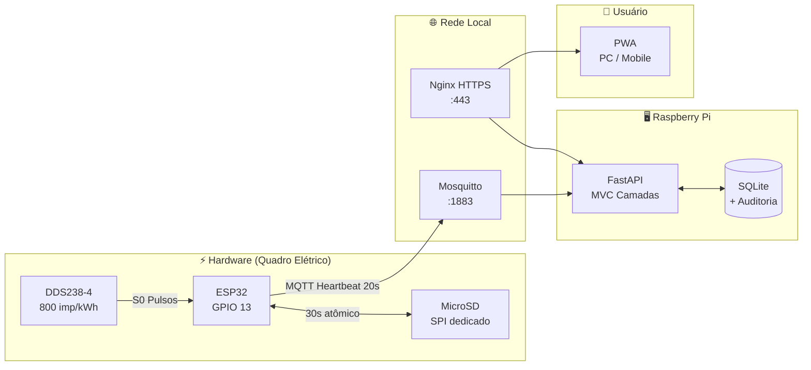
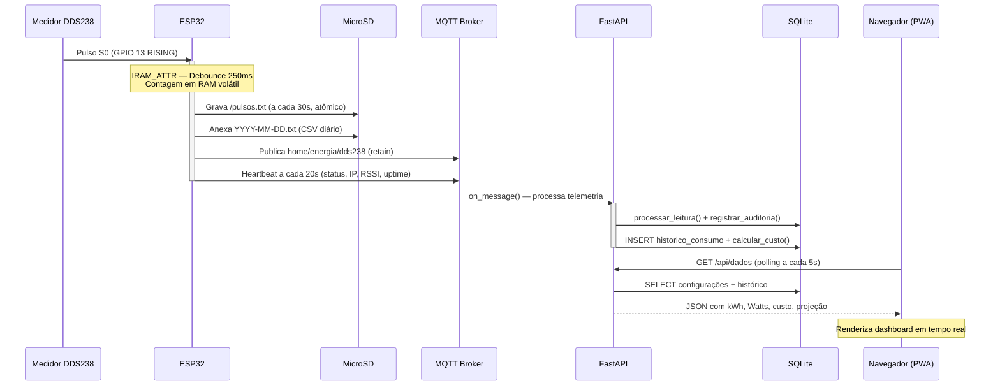
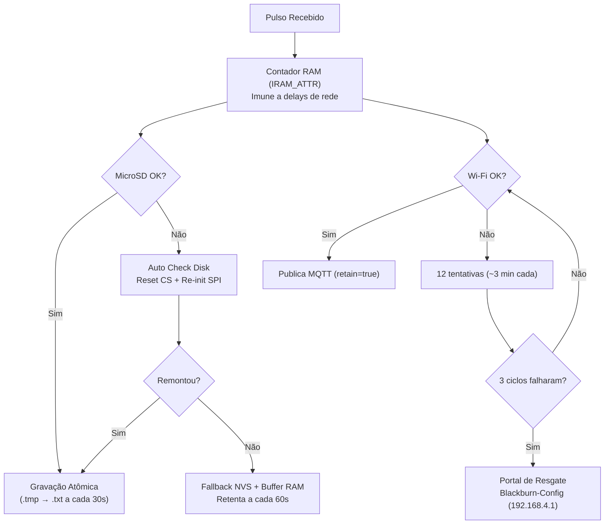
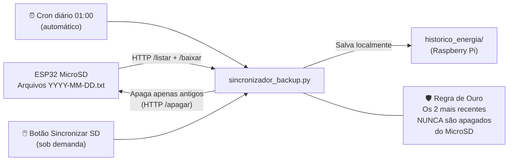

<p align="center">
  
</p>

<h1 align="center">⚡ Blackburn-Pulse</h1>

<p align="center">
  <strong>Medição Residencial Inteligente de Alta Disponibilidade</strong><br/>
  <em>Monitoramento de energia em tempo real com IoT, cálculo tributário fiel à concessionária e redundância total de dados.</em>
</p>

<p align="center">
  
  
  
  
  
  
</p>

---

## 🎯 O que é?

O **Blackburn-Pulse** é um ecossistema IoT completo que transforma o medidor de energia residencial DDS238-4 em uma central de monitoramento inteligente. Ele captura cada pulso de consumo em hardware, transmite em tempo real via MQTT e apresenta tudo em um painel web PWA com cálculos tributários idênticos à fatura da concessionária (Enel SP — modelo "por dentro").

> **Nomeado em homenagem a Oliver B. Shallenberger**, inventor do medidor de energia de indução, e inspirado no legado de engenharia de precisão da **Blackburn** em instrumentação elétrica.

---

## ✨ Funcionalidades Principais

| Área | Descrição |
|---|---|
| ⚡ **Leitura em Tempo Real** | Captura de pulsos via interrupção de hardware com debounce óptico calibrado |
| 📊 **Dashboard PWA** | Painel responsivo instalável com consumo ao vivo, projeção mensal e custo estimado |
| 💰 **Cálculo Tributário Completo** | ICMS por faixa (Enel SP), PIS, COFINS, bandeira tarifária ANEEL e COSIP municipal |
| 📈 **Analytics Avançado** | Perfil de 24h, consumo por dia da semana, comparativo de 12 meses e curvas temporais |
| 🔒 **Auditoria Rastreável** | Log permanente de toda alteração de config, quedas do ESP32 e sincronizações |
| 💾 **Backup Redundante** | Gravação atômica no MicroSD + sincronização remota com retenção dos 2 mais recentes |
| 📄 **Faturas em PDF** | Geração de faturas detalhadas com memória de cálculo para qualquer ciclo |
| 🛡️ **Alta Disponibilidade** | Contagem 100% offline em RAM, fallback NVS, auto-recuperação do SD e portal de resgate Wi-Fi |

---

## 🏗️ Arquitetura do Sistema



---

## 🔄 Fluxo de Dados — Do Pulso ao Painel



---

## 🛡️ Mecanismos de Resiliência



---

## 📂 Estrutura do Projeto

```text
Energia/
├── main.py                       # Entry point FastAPI (~35 linhas)
├── banco_energia.db              # SQLite — histórico + config + auditoria
├── sincronizador_backup.py       # Sync remoto do MicroSD com retenção
│
├── static/                       # PWA: manifest, service worker, tema
├── templates/                    # Jinja2: index, analytics, auditoria, manual
│
├── app/                          # Núcleo MVC (Clean Code)
│   ├── core/database.py          # Conexão SQLite + init_db()
│   ├── models/__init__.py        # Bandeiras ANEEL (5 faixas)
│   ├── services/
│   │   ├── energia_service.py    # calcular_custo() + processar_leitura()
│   │   ├── auditoria_service.py  # registrar_auditoria()
│   │   └── mqtt_service.py       # Telemetria MQTT em tempo real
│   └── routes/
│       ├── pages.py              # 6 rotas HTML
│       └── api/
│           ├── energia.py        # 14 endpoints (dados, faturas, PDF, config)
│           ├── analytics.py      # Curvas, perfis, comparativos
│           └── auditoria.py      # Logs, backup SD, restauração
│
├── esp32/esp32.ino               # Firmware C++ completo do ESP32
└── historico_energia/            # Backups diários do MicroSD (gerado)
```

---

## 🚀 Início Rápido

### Pré-requisitos

| Componente | Versão / Especificação |
|---|---|
| Python | 3.11+ |
| Raspberry Pi | 3B+ ou superior (Raspberry Pi OS) |
| ESP32 | DevKit v1 (30 pinos) |
| Medidor | DDS238-4 (800 pulsos/kWh) |
| MicroSD | FAT32, qualquer capacidade |
| Broker MQTT | Mosquitto |

### Instalação no Raspberry Pi

```bash
# 1. Clone o repositório
git clone https://github.com/andmuniz/blackburn-pulse.git
cd blackburn-pulse

# 2. Crie o ambiente virtual e instale dependências
python3 -m venv .venv
source .venv/bin/activate
pip install fastapi uvicorn paho-mqtt jinja2 python-multipart requests fpdf2

# 3. Inicie o servidor
uvicorn main:app --host 127.0.0.1 --port 8000
```

### Flash do Firmware no ESP32

1. Abra `esp32/esp32.ino` na **Arduino IDE**
2. Instale o board package **ESP32 by Espressif** e as bibliotecas: `PubSubClient`, `ArduinoOTA`, `SD`
3. Configure o SSID, senha Wi-Fi e IP do broker MQTT no código
4. Faça upload via USB (primeira vez) ou **OTA** (atualizações futuras)

---

## 📊 Telas do Sistema

| Dashboard | Analytics | Auditoria |
|:---------:|:---------:|:---------:|
| Consumo ao vivo, watts, custo e projeção | Perfil 24h, dias da semana, comparativo 12 meses | Logs filtráveis, KPIs do ESP32, backup SD |

---

## 🔄 Política de Backup (Regra de Ouro)



---

## 🛠️ Tecnologias

<table>
<tr>
<td align="center"><strong>Firmware</strong></td>
<td align="center"><strong>Backend</strong></td>
<td align="center"><strong>Frontend</strong></td>
<td align="center"><strong>Infra</strong></td>
</tr>
<tr>
<td>C++ / Arduino<br/>ESP32 (Espressif)<br/>PubSubClient<br/>ArduinoOTA<br/>SD + SPI</td>
<td>Python 3.13<br/>FastAPI + Uvicorn<br/>Paho MQTT<br/>SQLite3<br/>FPDF2</td>
<td>HTML5 + CSS3<br/>JavaScript (Vanilla)<br/>Chart.js<br/>PWA + Service Worker<br/>Jinja2 Templates</td>
<td>Raspberry Pi OS<br/>Nginx (HTTPS + mkcert)<br/>Mosquitto MQTT<br/>Pi-hole DNS<br/>systemd</td>
</tr>
</table>

---

## 📜 Licença

Distribuído sob a licença **MIT**. Veja [LICENSE](LICENSE) para mais informações.

---

<p align="center">
  <sub>Feito por <strong>Anderson Muniz</strong> — Engenharia embarcada e software unidos pela eficiência energética.</sub>
</p>
